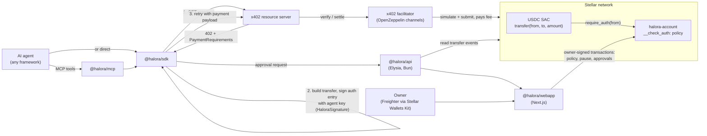

# SCF Build Award Application: Halora (draft)

Status: draft v1, 2026-10-16. Track: **Open Track**. Requested amount: **USD 72,000** in XLM.

Placeholders marked **[FOUNDER TO FILL]** must be completed before submission. SCF reviewers assess only what is in the submission ("No external materials are considered"), so every claim below must stand on its own. Facts about third-party systems are sourced in [`docs/strategy/integration-verification-matrix.md`](../strategy/integration-verification-matrix.md).

---

## 1. Project summary

Halora gives AI agents a Stellar wallet with rules they cannot break. An owner deploys a Soroban custom account for each agent, funds it with USDC, and sets a policy: per-payment limit, daily limit, allowed recipients, approval threshold, pause and expiry. The agent holds its own key and pays for APIs on its own, including x402 pay-per-request. Every payment is checked by the account contract in `__check_auth` before the transfer can happen, so a manipulated or buggy agent cannot spend more than its owner allowed. Halora ships the contract with a TypeScript SDK, an MCP server, an approvals API and an owner dashboard.

## 2. Problem

AI agents now call paid APIs and services, and machine-payment standards such as x402 (settled on Stellar today) let them pay per request. But giving an agent money is unsafe:

- A plain wallet key lets the agent, or anyone who manipulates it through prompt injection, spend everything.
- Vendor policy engines (for example Coinbase CDP or Turnkey) check rules in the vendor's signing infrastructure, document mostly per-operation rules, and do not document Stellar support.
- Off-chain spend limits in an MCP server or proxy fail when the host they run on is compromised.

There is no packaged way on Stellar for a developer to hand an agent a budget that is enforced on-chain and works with x402.

## 3. Solution

**On-chain:** `halora-account`, one Soroban custom account per agent.

- Agent signatures may only authorize `transfer(from = this account, to, amount)` on the policy token. Any other call is rejected.
- Checks, in order: not paused, not expired, recipient allowed (if the allowlist is on), amount within the per-payment limit, today's total within the daily limit, owner approval present if the amount is above the threshold.
- The owner key can change the policy, rotate the agent key, pause and withdraw. The agent key can never change the policy.
- Fail closed: anything unexpected is denied.

**Off-chain, for usability (never for enforcement):**

- `@halora/sdk`: deploy and configure accounts, sign agent payments, x402-aware `fetch`, approval requests, local pre-flight that mirrors the contract's checks to return clear errors early.
- `@halora/mcp`: an MCP server so any MCP-capable agent can check its budget, pay, fetch paid resources and track approvals.
- `@halora/api`: approval queue, payment log built from chain data, owner notifications.
- `@halora/webapp`: owner dashboard to create agent wallets, edit policies, approve payments and see spending, with Freighter and other wallets through Stellar Wallets Kit.

## 4. Why Stellar

- **Programmable accounts:** Soroban's custom account interface lets the account contract decide what each signature may authorize. This is Halora's enforcement point and is native to Stellar.
- **x402 on Stellar works with contract accounts:** the x402 `exact` scheme for Stellar uses auth-entry signing, which the specification states supports both contract (C) and classic (G) accounts. A facilitator pays the fee, so the agent needs no XLM.
- **Economics:** sub-cent fees and about 5 second finality make per-request payments viable.
- **Native USDC** through the Stellar Asset Contract.
- **Ecosystem momentum:** mainnet x402 facilitator (OpenZeppelin Relayer plugin), SDF membership in the x402 Foundation (reported at its 2026-07-14 launch), Protocol 27 auth improvements live, Confidential Tokens on testnet and ML-DSA host functions accepted, which give Halora a path to private and post-quantum agent payments.

Stellar is not used for storage or as a thin integration: the core product guarantee (the spending policy) exists only because of Soroban custom accounts.

## 5. Technical architecture

**Payment flow (x402):** the SDK receives HTTP 402 with the `exact` requirements (asset, `payTo`, amount, timeout), builds a single `transfer` invocation from the Halora account, simulates it, signs the authorization entry with the agent key in Halora's signature format, and sends the transaction XDR to the resource server. The facilitator re-simulates (which runs the account's `__check_auth`, so the policy is enforced during verification and again at settlement), rebuilds the transaction as fee payer and submits it.

**Direct payments:** `HaloraAgent.pay` builds the same `transfer`, signs the auth entry and submits through a fee-sponsoring path or the developer's own funded account.

**Above-threshold payments:** the SDK creates an approval request in the API with the agent's justification. The owner approves in the dashboard with their wallet. Because x402 authorizations expire in about a minute, approvals for x402 are recorded on-chain by the owner and consumed by the next matching agent payment (design detail tracked in the decision log).

**Contract interface (summary):** constructor `(owner, agent, policy)`; owner methods `set_policy`, `set_agent`, `pause`, `unpause`; views `owner`, `agent`, `policy`, `spent_today`; ten typed errors (`Paused`, `Expired`, `RecipientNotAllowed`, `PerTxLimitExceeded`, `DailyLimitExceeded`, `ApprovalRequired`, and others). Full specification: `docs/architecture/interfaces.md` in the repository.

**Security model:** enforcement is in the account contract. A compromised SDK, API, MCP server or agent runtime cannot exceed the policy. The agent key can be rotated by the owner. Halora never holds user keys. The owner key is all-powerful by design. The contract will be open source under **[FOUNDER TO FILL: license, recommended Apache-2.0]** from the first commit and submitted to the SCF Audit Bank before mainnet.

**Stack:** Rust and soroban-sdk for the contract; TypeScript on Bun for SDK, API (Elysia) and MCP server (official MCP TypeScript SDK); Next.js for the dashboard; Stellar RPC for simulation, submission and events.

## 6. Team

**[FOUNDER TO FILL]** for each person: name, role in this project, relevant experience (Rust/Soroban, TypeScript, payments, security), links to GitHub and previous shipped work, time commitment (hours per week), location (for jurisdiction checks).

| Role                                       | Person            | Commitment        |
| ------------------------------------------ | ----------------- | ----------------- |
| Founder, product and full-stack TypeScript | [FOUNDER TO FILL] | [FOUNDER TO FILL] |
| Soroban / Rust engineer                    | [FOUNDER TO FILL] | [FOUNDER TO FILL] |
| Design and QA (part-time)                  | [FOUNDER TO FILL] | [FOUNDER TO FILL] |

**Use of AI disclosure (required for Open Track):** [FOUNDER TO FILL: describe honestly which documents and code were written or assisted by AI tools, and how they are reviewed.]

**Video presentation (recommended for Open Track):** [FOUNDER TO FILL: link to a short team video.]

## 7. Budget

Total: **USD 72,000** over 5 months (6 month maximum). Built bottom-up from hours. Rates: Soroban/Rust engineer USD 70 per hour, TypeScript engineer USD 60 per hour, design and QA USD 50 per hour. **[FOUNDER TO FILL: confirm rates and that they match the actual team.]**

Excluded, per SCF guidelines: audit costs (requested separately through the Audit Bank), marketing and user acquisition, legal and entity costs, past work.

### By role

| Role                                        | Hours     | Rate (USD) | Cost (USD) |
| ------------------------------------------- | --------- | ---------- | ---------- |
| Soroban / Rust engineer                     | 290       | 70         | 20,300     |
| TypeScript engineer (SDK, API, MCP, webapp) | 760       | 60         | 45,600     |
| Design and QA                               | 122       | 50         | 6,100      |
| **Total**                                   | **1,172** |            | **72,000** |

### By tranche

SCF pays 10 percent on acceptance (T0), then 20, 30 and 40 percent on completion of T1, T2 and T3. The T0 payment funds the start of T1 work, so T1 deliverables below are costed at T0 plus T1 (30 percent).

| Tranche           | Share | Amount (USD) | Funds deliverables   |
| ----------------- | ----- | ------------ | -------------------- |
| T0, on acceptance | 10%   | 7,200        | Start of T1 work     |
| T1, MVP           | 20%   | 14,400       | T1 (with T0: 21,600) |
| T2, Testnet       | 30%   | 21,600       | T2                   |
| T3, Mainnet       | 40%   | 28,800       | T3                   |
| **Total**         | 100%  | **72,000**   |                      |

## 8. Tranche deliverables

### Tranche 1: MVP (USD 21,600 including T0; target end of month 2)

| #   | Deliverable                                                                              | Cost (USD)            | How reviewers verify                                                                                                                                           |
| --- | ---------------------------------------------------------------------------------------- | --------------------- | -------------------------------------------------------------------------------------------------------------------------------------------------------------- |
| 1.1 | `halora-account` contract with all policy rules and full unit tests, deployed on testnet | 8,400 (Soroban 120 h) | Public repo, CI green, one test per error code and rule, testnet contract ID published                                                                         |
| 1.2 | `@halora/sdk` core and `@halora/shared` (deploy, configure, agent pay, pre-flight)       | 6,600 (TS 110 h)      | Example script runs against testnet; package README                                                                                                            |
| 1.3 | Halora x402 client in the SDK                                                            | 3,600 (TS 60 h)       | Recorded run: an agent pays a testnet x402 endpoint through a public facilitator; an over-limit payment is rejected by the contract; transaction hashes listed |
| 1.4 | `@halora/mcp` core tools (status, pay, paid fetch)                                       | 3,000 (TS 50 h)       | Video of an MCP agent paying within budget and being refused over budget                                                                                       |

### Tranche 2: Testnet (USD 21,600; target end of month 3.5)

| #   | Deliverable                                                                              | Cost (USD)                    | How reviewers verify                                                                            |
| --- | ---------------------------------------------------------------------------------------- | ----------------------------- | ----------------------------------------------------------------------------------------------- |
| 2.1 | Approval flow for above-threshold payments (API queue, owner approval, contract support) | 7,500 (TS 90 h, Soroban 30 h) | Testnet demo: request, approve with Freighter, settle; reject and expiry paths covered by tests |
| 2.2 | Owner dashboard: create wallet, edit policy, pause, rotate agent key, spending view      | 7,200 (TS 120 h)              | Public testnet URL, walkthrough video                                                           |
| 2.3 | Payment indexer and owner notifications                                                  | 3,000 (TS 50 h)               | Log matches on-chain transfers for 100 test payments with zero mismatches                       |
| 2.4 | Threat model (STRIDE) and on-chain monitoring plan; property tests on limit arithmetic   | 2,800 (Soroban 40 h)          | Documents in the repo using SDF templates; tests in CI                                          |
| 2.5 | Testnet QA protocol and results                                                          | 1,100 (QA 22 h)               | Published test protocol and results                                                             |

### Tranche 3: Mainnet (USD 28,800; target end of month 5)

| #   | Deliverable                                                                      | Cost (USD)                    | How reviewers verify                                                                          |
| --- | -------------------------------------------------------------------------------- | ----------------------------- | --------------------------------------------------------------------------------------------- |
| 3.1 | Audit remediation and mainnet deployment of `halora-account`                     | 5,600 (Soroban 80 h)          | Mainnet WASM hash and reproducible build instructions; audit findings addressed or documented |
| 3.2 | Production API with monitoring and mainnet RPC provider                          | 5,400 (TS 90 h)               | Public status endpoint; ops runbook in the repo                                               |
| 3.3 | Mainnet onboarding UX (guided agent wallet creation, fixes from QA)              | 9,000 (TS 100 h, design 60 h) | Live mainnet dashboard; walkthrough video                                                     |
| 3.4 | `@halora/sdk` and `@halora/mcp` 1.0 on npm, developer docs, three example agents | 5,400 (TS 90 h)               | npm packages, docs site, examples run against mainnet                                         |
| 3.5 | External onboarding QA with at least 5 developers outside the team               | 2,000 (QA 40 h)               | Written findings; median time to first bounded payment reported                               |
| 3.6 | Monitoring and alerts from the T2 plan running on mainnet                        | 1,400 (Soroban 20 h)          | Alert configuration in the repo; test alert evidence                                          |

## 9. Success metrics

At T3 completion:

- Policy-checked x402 payments settled on mainnet through a public facilitator, with transaction hashes, including at least one over-limit attempt rejected by the contract.
- At least 5 external developers complete the quickstart; median time to first bounded testnet payment under 10 minutes.
- SDK and MCP server published at 1.0 with documentation.

Within 90 days after launch (goals, not tranche conditions):

- 25 agent accounts created by people outside the team.
- 2,000 policy-checked payments on mainnet.
- At least 2 x402 service providers on Stellar listing Halora as a supported payer, or integrating it in their docs.

## 10. Go-to-market

- **Developers first.** Open source repo, quickstart, examples for popular agent frameworks, and the MCP server as the lowest-friction entry point.
- **x402 service providers as allies.** Halora agents are new paying customers for them at no integration cost. Work with providers already listed in the Stellar x402 ecosystem to publish joint examples.
- **Stellar ecosystem tools.** Offer Halora as the account layer for x402 and MCP tooling on Stellar (including SDF's announced x402-MCP work) rather than competing with it.
- **Companies running agents** through the dashboard once the developer path is proven.
- Business model after the pilot: **[FOUNDER TO FILL: for example a hosted API and dashboard tier for teams, with the contract, SDK and MCP server remaining open source.]**

No SCF funds are used for marketing.

## 11. Traction and validation

**[FOUNDER TO FILL]**: conversations with agent developers or x402 providers, letters of interest, waitlist numbers, community feedback, relevant prior work. Product readiness criteria require "a clearly validated need identified by a team or individual with relevant experience in the Stellar ecosystem", so concrete evidence here matters.

Current state of the build (pre-award, not billed): architecture and interface specification complete; repository with contract, SDK, API, MCP and webapp workspaces. **[FOUNDER TO FILL: link to repo and what works today at submission time.]**

## 12. Risks and mitigations

| Risk                                                                                                       | Likelihood          | Mitigation                                                                                                                                 |
| ---------------------------------------------------------------------------------------------------------- | ------------------- | ------------------------------------------------------------------------------------------------------------------------------------------ |
| Facilitators reject payments from a custom account (signature format, events emitted during authorization) | Medium              | Tested in T1 against two facilitators; contract emits no events during authorization if needed; open source facilitator plugin as fallback |
| Owner approvals cannot meet x402's short authorization window                                              | High if unaddressed | On-chain pre-approval consumed by the next matching payment (T2)                                                                           |
| Contract bug lets an agent exceed policy                                                                   | Low to medium       | Exhaustive unit and property tests, threat model, Audit Bank review before mainnet, fail-closed design, owner pause                        |
| Agent key leaked                                                                                           | Medium              | Damage bounded by policy; owner can pause and rotate the key; docs on key storage                                                          |
| Overlap with SDF or ecosystem agent payment tooling                                                        | Medium              | Position as the account layer others can use; keep SDK framework-agnostic                                                                  |
| Protocol changes to auth credentials (CAP-71 V2)                                                           | Low                 | SDK supports both credential formats; follow protocol release notes                                                                        |
| Small team, 6 month limit                                                                                  | Medium              | Scope fixed to one token and one policy shape; backlog deferred explicitly                                                                 |

## 13. Open source plan

All smart contracts, the SDK, MCP server, API and webapp are public on GitHub under **[FOUNDER TO FILL: license]** from the start of the award. Releases are tagged per tranche.

## 14. Future phases (not funded by this award)

- Phase 2: private agent payments with Stellar Confidential Tokens once they reach mainnet with an audit.
- Phase 3: post-quantum owner and agent keys using ML-DSA host functions (CAP-87) once activated.

See `docs/strategy/roadmap.md`.
