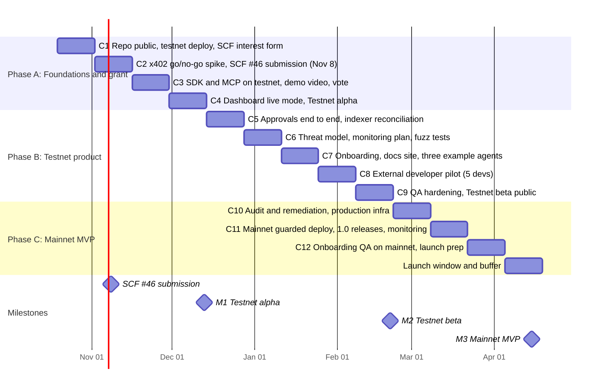

# MVP roadmap: six months to mainnet

Status: v1, 2026-10-19. Owner: founder. This is the calendar plan; [`../strategy/roadmap.md`](../strategy/roadmap.md) is the phase plan it executes (SCF tranches T1 to T3 for the pilot). Where the two disagree on scope, the strategy roadmap wins; where they disagree on dates, this file wins.

**Target: Halora MVP live on Stellar mainnet on 2027-04-15**, six months from today, ahead of the SCF hard stop.

## What "MVP" means

An external developer, without talking to us, can:

1. Open the dashboard, connect Freighter and create an agent wallet on **mainnet** with a policy (per payment limit, daily limit, allowlist, approval threshold, expiry).
2. Connect an agent through `@halora/sdk` or `@halora/mcp` in under 10 minutes.
3. Watch the agent pay a real x402 endpoint within the policy, see an over-limit payment refused by the contract, and approve a held payment from the dashboard.
4. Read every payment in the dashboard log, matching the chain.

Guarded launch: mainnet policies are capped (per payment 100 USDC, daily 500 USDC) until the audit findings are closed and 30 days pass without an incident.

Out of the MVP: Confidential Tokens (phase 2), ML-DSA keys (phase 3), multiple tokens per policy, hosted custody, a Halora-run facilitator.

## Calendar

Twelve two-week cycles plus a launch window. Each cycle has one goal, a demo at its end, and a file in [`cycles/`](cycles/).

| Cycle  | Dates            | Goal                                                                                                                           | Demo at the end                               |
| ------ | ---------------- | ------------------------------------------------------------------------------------------------------------------------------ | --------------------------------------------- |
| C1     | Oct 19 to Nov 1  | Public repo with green CI, contract on testnet, SCF interest form sent, landing deployed                                       | Contract ID on testnet, landing URL           |
| C2     | Nov 2 to Nov 15  | **x402 go/no-go:** a Halora account pays a real testnet x402 endpoint through a public facilitator. SCF #46 submitted by Nov 8 | Recorded x402 payment and rejection           |
| C3     | Nov 16 to Nov 29 | SDK and MCP against testnet; demo video; community vote support                                                                | Claude paying through `@halora/mcp`           |
| C4     | Nov 30 to Dec 13 | Dashboard live mode on testnet (Freighter signing), API on staging                                                             | **M1 Testnet alpha** (SCF T1 scope)           |
| C5     | Dec 14 to Dec 27 | Approval flow end to end; indexer reconciled against chain (100 payments, zero mismatches)                                     | Held payment approved from the dashboard      |
| C6     | Dec 28 to Jan 10 | STRIDE threat model, monitoring plan, property and fuzz tests on limit arithmetic; SCF Audit Bank request                      | Threat model merged                           |
| C7     | Jan 11 to Jan 24 | Guided onboarding, docs site with quickstart, three example agents, English and Spanish                                        | Time to first payment under 10 min (internal) |
| C8     | Jan 25 to Feb 7  | External developer pilot: 5 developers on testnet, interviews                                                                  | Pilot findings report                         |
| C9     | Feb 8 to Feb 21  | Fix pilot findings, QA protocol, public testnet URL                                                                            | **M2 Testnet beta** (SCF T2 scope)            |
| C10    | Feb 22 to Mar 7  | Audit, remediation, production infra (RPC, Postgres, secrets, uptime)                                                          | Audit report and fixes                        |
| C11    | Mar 8 to Mar 21  | Mainnet deploy with caps, `@halora/sdk` and `@halora/mcp` 1.0 on npm, alerts live                                              | First mainnet x402 payment                    |
| C12    | Mar 22 to Apr 4  | External onboarding QA on mainnet, launch assets, SCF T3 package                                                               | 5 external devs on mainnet                    |
| Launch | Apr 5 to Apr 18  | Buffer, launch on Apr 15                                                                                                       | **M3 Mainnet MVP**                            |

## Milestones and gates

| Milestone        | Date   | Gate (all must be true)                                                                                                                                                                                 |
| ---------------- | ------ | ------------------------------------------------------------------------------------------------------------------------------------------------------------------------------------------------------- |
| x402 go/no-go    | Nov 13 | A Halora custom account payment accepted by at least one public facilitator on testnet. **If no:** run our own facilitator from the open-source plugin for testnet and keep direct payments; re-plan C3 |
| M1 Testnet alpha | Dec 13 | Contract on testnet with one test per error code, SDK and MCP pay and refuse on testnet, dashboard creates an account with Freighter                                                                    |
| M2 Testnet beta  | Feb 21 | Approvals end to end, indexer reconciled, threat model and monitoring plan published, 5 external developers completed the quickstart                                                                    |
| M3 Mainnet MVP   | Apr 15 | Audit findings closed or documented, mainnet deploy with published WASM hash, 1.0 packages on npm, alerts live, time to first payment under 10 min for external testers                                 |

## Workstreams

| Workstream       | Owns                                                             | Lead role           |
| ---------------- | ---------------------------------------------------------------- | ------------------- |
| Contracts        | `apps/contracts`, deploy scripts, audit, monitoring              | Soroban engineer    |
| SDK and MCP      | `apps/shared`, `apps/sdk`, `apps/mcp`, npm releases, examples    | TypeScript engineer |
| Platform         | `apps/api`, infra, indexer, notifications                        | TypeScript engineer |
| Product          | `apps/webapp`, onboarding, docs site, design system              | Frontend and design |
| Grant and growth | SCF submissions and tranche reports, pilot recruiting, community | Founder             |

With one or two people, the founder covers Grant and growth plus one engineering workstream; the cycle goals above already assume that load (one goal per cycle).

## KPIs at M3

- Time to first bounded payment for an external developer: under 10 minutes.
- External developers who completed the quickstart: at least 10 (5 testnet, 5 mainnet).
- Agent payments checked on mainnet in the first 30 days: at least 1,000, with zero policy bypasses.
- Indexer accuracy: zero mismatches against chain over the period.
- Uptime of API and dashboard: 99.5 percent.

## Risks

| Risk                                         | Likelihood | Impact | Mitigation                                                                         |
| -------------------------------------------- | ---------- | ------ | ---------------------------------------------------------------------------------- |
| Facilitators reject a custom-account payer   | Medium     | High   | Go/no-go in C2; own facilitator from the open-source plugin as fallback            |
| SCF #46 not awarded or late invitation       | Medium     | Medium | The plan does not depend on the award until C10; resubmit in SCF #47               |
| Audit slot not available before C10          | Medium     | High   | Request the SCF Audit Bank in C6; guarded launch caps limit exposure               |
| SDF ships an x402 MCP with spending policies | Medium     | Medium | Position Halora as the on-chain account layer such tools can use; offer an adapter |
| Small team bandwidth                         | High       | Medium | One goal per cycle; backlog cut explicitly; buffer in the launch window            |
| Protocol changes on Stellar                  | Low        | Medium | Track protocol releases in the verification matrix every cycle                     |

## Rituals

- **Cycle start (Monday):** pick the cycle's issues from [`backlog.md`](backlog.md) into `cycles/cycle-NN.md`.
- **Cycle end (second Sunday):** demo, update the verification matrix and the decision log, mark the cycle file done.
- **Monthly:** update this roadmap's dates if a gate slipped, never silently.
