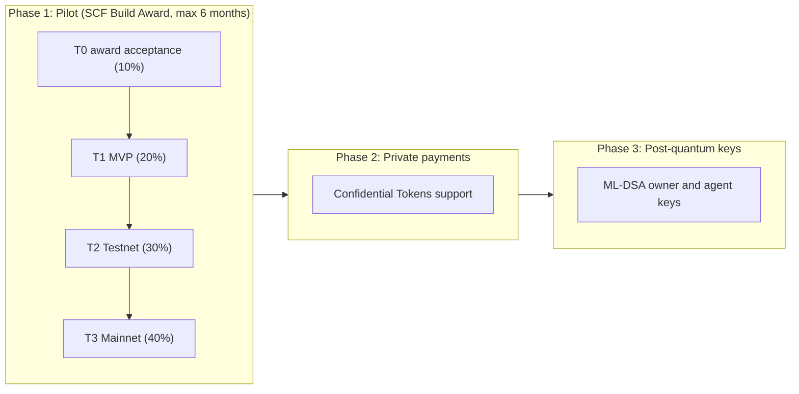

# Roadmap

Three phases. Each later phase is gated on the previous one being live and used, not on the calendar.

Timing is expressed in months from award acceptance (M0). If Halora is awarded in SCF #46 (community vote ends 2026-12-03), M0 is expected in December 2026 and the pilot ends by June 2027. SCF requires each tranche to be submitted within 90 days of the previous payment.

---

## Phase 1: Pilot (SCF tranches)

### T0: Award acceptance (10 percent, M0)

Paid on acceptance, not tied to deliverables. It funds the start of T1 work. Pre-award work already done in the repo (architecture, interfaces, early code) is not billed to SCF.

### T1: MVP (20 percent, target end of M2)

Goal: an agent can make a policy-checked payment on testnet, directly and through x402.

| Deliverable                                                           | Acceptance criteria (how a reviewer checks it)                                                                                                                                                                                         |
| --------------------------------------------------------------------- | -------------------------------------------------------------------------------------------------------------------------------------------------------------------------------------------------------------------------------------- |
| D1.1 `halora-account` contract, all policy rules, deployed on testnet | Public repo; `cargo test` passes in CI with one test per error code (1 to 10) and per authorization rule; testnet contract ID published in `contracts.testnet.json`; README explains each rule                                         |
| D1.2 `@halora/sdk` core and `@halora/shared`                          | `deployAccount`, `getPolicy`, `setPolicy`, `HaloraAgent.pay` work against testnet; local pre-flight returns typed errors; example script in the repo runs green                                                                        |
| D1.3 Halora x402 client                                               | `HaloraAgent.fetch` pays a testnet x402 endpoint through a public facilitator; a recorded run shows one payment under the limit settles and one over the limit is rejected by the contract; result recorded in the verification matrix |
| D1.4 `@halora/mcp` (core tools)                                       | `halora_status`, `halora_pay`, `halora_fetch_paid` usable from an MCP client; video of an agent paying and being refused when over budget                                                                                              |

### T2: Testnet product (30 percent, target end of M3.5)

Goal: the full owner experience works on testnet, with a threat model and monitoring plan (SCF requirement for T2).

| Deliverable                                     | Acceptance criteria                                                                                                                                                                               |
| ----------------------------------------------- | ------------------------------------------------------------------------------------------------------------------------------------------------------------------------------------------------- |
| D2.1 Approval flow for above-threshold payments | Agent request appears in the dashboard; owner approves with Freighter; payment settles; rejection and expiry paths tested. Works for x402 using the approval mechanism chosen in the decision log |
| D2.2 Owner dashboard                            | Create agent wallet, edit policy, pause, rotate agent key, see balance and spending, all on testnet with Freighter through Stellar Wallets Kit; public testnet URL                                |
| D2.3 Payment indexer and notifications          | Payment log in the API matches on-chain transfers for a test account over 100 payments with zero mismatches; owner notified on approval requests                                                  |
| D2.4 Threat model and monitoring plan           | STRIDE threat model and on-chain monitoring plan using SDF templates, published in the repo; property or fuzz tests on limit arithmetic                                                           |
| D2.5 Testnet QA pass                            | Written test protocol and results for the end-to-end flows, issues triaged                                                                                                                        |

### T3: Mainnet launch (40 percent, target end of M5, hard stop M6)

Goal: a functional product live on Stellar mainnet with proven onboarding (SCF final tranche).

| Deliverable                                   | Acceptance criteria                                                                                                                                                   |
| --------------------------------------------- | --------------------------------------------------------------------------------------------------------------------------------------------------------------------- |
| D3.1 Audit remediation and mainnet deployment | Audit findings (SCF Audit Bank, if eligible) addressed or documented; `halora-account` WASM deployed on mainnet with hash published and verifiable build instructions |
| D3.2 Production API                           | API live with uptime monitoring; mainnet RPC provider configured; secrets handling documented                                                                         |
| D3.3 Onboarding UX                            | Guided "create an agent wallet" flow on mainnet; changes from QA sessions shipped; time to first bounded payment under 10 minutes for external testers                |
| D3.4 Public releases and docs                 | `@halora/sdk` and `@halora/mcp` 1.0 on npm; developer docs with quickstart; three example agents (direct pay, x402 fetch, MCP)                                        |
| D3.5 External onboarding QA                   | At least 5 developers outside the team complete the quickstart; findings written up                                                                                   |
| D3.6 Monitoring live                          | Alerts from the monitoring plan running against mainnet contracts                                                                                                     |

Mainnet proof for reviewers: transaction hashes of policy-checked x402 payments on mainnet, including at least one rejected over-limit attempt, and the public dashboard URL.

---

## Phase 2: Private payments with Confidential Tokens

**Gate:** Confidential Tokens on mainnet with a completed audit, and Halora pilot live.

**Status of the dependency (2026-10-16):** testnet developer preview; amounts and balances hidden with zero-knowledge proofs, addresses public; auditor viewing keys; audit pending; no mainnet date published.

**What it would add:** agents pay without revealing amounts to the public (useful for companies that do not want competitors to read their API spend), while the owner and an auditor can still see everything through viewing keys.

**Hard problem to solve first:** Halora's limits read the transfer `amount` in `__check_auth`. With confidential transfers the amount is encrypted, so the account cannot compare it to a limit directly. Options to research: require a zero-knowledge proof that the hidden amount is below the per-payment limit and that the running total stays below the daily limit; or keep limits on a public "funding" step and allow private spending inside a pre-funded envelope. This needs a design spike before any commitment.

**Candidate deliverables:** design note and spike; policy enforcement for confidential transfers on testnet; SDK and dashboard support with viewing-key based spending log.

## Phase 3: Post-quantum keys (ML-DSA)

**Gate:** CAP-87 (ML-DSA signature verification host functions) activated in a protocol release on mainnet. Status 2026-10-16: Accepted, protocol version TBD.

**What it would add:** owner and agent keys that remain secure against a future quantum attacker. The account contract already chooses its own signature scheme, so this is a contract and SDK change, not a migration of the user's account model.

**Design notes:** add ML-DSA variants to `HaloraSignature`; ML-DSA public keys (about 1.3 to 2.6 KB) and signatures (about 2.4 to 4.6 KB) are much larger than ed25519, which raises transaction size and fees; owner key rotation must support switching scheme without moving funds.

**Candidate deliverables:** ML-DSA-65 owner key on testnet; hybrid mode (ed25519 plus ML-DSA) for the owner; benchmark of fee impact per payment.

---

## Not on the roadmap yet (backlog)

Multiple tokens per policy, per-recipient limits, anomaly detection, OpenZeppelin-compatible policy contracts (see decision log), a Halora-operated x402 facilitator, hosted key custody (would require a separate security and legal review).
